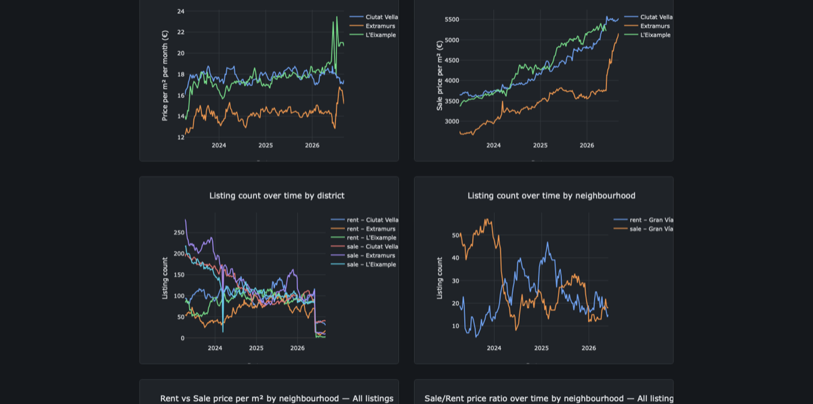

### Leopold Walther

Senior Data Engineer in Munich. Nine years of vehicle data at BMW, mechanical engineer by training. I build analytics pipelines that find errors in connected products before a customer reports them: lakehouse on AWS, PySpark, Apache Iceberg, Terraform, everything as code and tested.

**Live project:** [VLC Market Pulse](https://vlc-market-pulse.leopoldwalther.com) · a serverless price-trend pipeline for the Valencia housing market, running weekly since 2023 for about €3 a month · [source](https://github.com/LeopoldWalther/vlc-market-pulse)

**Certified:** AWS Solutions Architect – Associate (2026) · AWS Cloud Practitioner (2024) · [verify](https://aws.amazon.com/verification) with IDs `d7cb9a6eab3449b1a11a14d1ae08f7d9` and `d2e5b45014544d69a725bb8e915dce9a`

**Stack:** AWS (S3, Glue, Athena, Lambda, Step Functions, EventBridge, QuickSight) · Apache Spark / PySpark · Polars · Apache Iceberg · Parquet · Terraform · GitHub Actions · Python · SQL

[LinkedIn](https://www.linkedin.com/in/leopoldwalther/)
